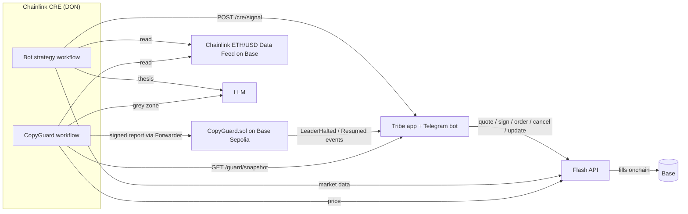

# Tribe: copy trading with a safety net, on Flash and Chainlink CRE

Tribe is a social trading app built around **trades**. A creator publishes a named set of tokens with target weights, a stop and a target; followers copy the trade with one tap, from their own wallet and within their own limits. Traders also post real trades to build their record; an AI agent run on Chainlink CRE trades in the open so anyone can copy it too. Every trade is a [Flash](https://flash.definitive.fi/docs) advanced order (entries ship with a take-profit / stop-loss bracket attached), and a [Chainlink CRE](https://docs.chain.link/cre) workflow acts as an onchain circuit breaker: it pauses copying of a trader who is blowing up, before the next copy fills.

Mobile-first web app (it reflows to a full desktop layout).

## Trades
A trade is what you copy on Tribe (`src/baskets.ts`, `src/views/baskets.ts`).

- **Build:** 1 to 10 tokens, at least 1% each, adding up to 100%, with an optional stop and target per token.
- **Mix and risk:** every trade shows its share in Major coins, US stocks, Altcoins and Meme coins, plus a Steady, Balanced or Aggressive band (`src/assets.ts`). Classes come from a reviewed list of contract addresses, never a token's name or a creator's tag; anything unreviewed is Unclassified and counts as the riskiest kind. Confirm a token's address with its issuer before adding it (Coinbase's tokenized stocks are listed at base.org/assets). The agent API can filter on this, with a trade counting for a class from 25% up.
- **Safety read:** every trade shows rule-based checks on its stop, spread, record and creator's Guard status. No AI is involved.
- **Copy:** Tribe runs your limits and CopyGuard once for the whole amount, then places one Flash order per token at its weight. The tokens sit in your own wallet; nothing is pooled.
- **Partial fills:** if a token won't fill, the rest still go through. The copy shows as partly filled, and you can try again or close it.
- **Rebalance:** a published version never changes. New weights make a new version and send every copier a request showing the exact sells and buys. Nothing moves until they approve.
- **Record:** a trade's value is an index that starts at 100 and moves with its weights and token prices, carried across versions, so it doesn't depend on what the creator holds.
- **Published by buying:** with `DRY_RUN=false` a creator publishes a trade by buying it with Flash, one order per token with their stops. If nothing goes through, nothing is published. That stake isn't counted as a copier.
- **Real money, in testing:** with `DRY_RUN=false` a copy places real Flash orders, one per token, capped at `BASKET_LIVE_MAX_USD` (default $25) per copy. Use a Privy wallet: a 5-token copy through MetaMask would need about 10 to 20 prompts. Rebalancing stays in practice mode; to change versions, close the copy and copy again.

Single trades are now each trader's record rather than something you copy. Bots still trade one token, and copying a bot still goes through the follow rules and `mirror` in `src/copy.ts`.

## Why it wins, in three lines
- **Social and gamified:** unique usernames with profile photos and bios, public profiles with a portfolio view, free follow or copy with Flash, a feed with story rings, levels, streaks, quests, badges, squads, a Hot pick and share cards. The game rewards safe behaviour: brackets, copying trades with stops, and researching before you copy.
- **Tribe Trading Cards:** making a trade earns an Original card and copying one earns a numbered Copy card, unlocked on screen right after the trade, each an SVG at `/card/<id>.svg`. Cards go BASE → GLITTER → HOLO on performance and keep the highest tier reached; the thresholds are in `src/card-tiers.ts`. Each card is minted as a transferable ERC-721 on Base Sepolia (`contracts/BasketCards.sol`, `npm run cards:deploy`), with Tribe paying the gas and recording tier upgrades. Metadata is at `/card/<id>.json`, and cards are marked as practice when their fills were simulated. In the feed, a trade wears the Glitter or Holo finish while its return since launch is in that range.
- **CRE security:** Chainlink CRE checks every trader and writes the verdict onchain. Tribe reads that contract right before every copy, and if CRE goes quiet, auto-copies wait for your OK.

## How Tribe meets the tracks

### Best Use of Flash Advanced Orders in a Social App
| Requirement | Where |
| --- | --- |
| Working trading flow on Flash advanced orders | `src/flash.ts`: quote → setup (approvals broadcast via Flash's `/setup-transaction`) → EIP-712 sign → order. Market with an **attached bracket** (entry + take-profit + stop-loss as one Flash order), limit, stop-loss, take-profit, standalone bracket, **TWAP**, stop-buy. Gasless signed **cancel**, **batch cancel** (a leader's cancel cancels every follower's resting copy) and **update** (move a live stop). The **orders WebSocket** delivers fills and close reasons live. **Permit2 with minimal allowance** is on by default, so no wallet carries an unlimited approval. **Limit orders with `expireTime`** power the chase limit: a copy never pays more than 1% above the leader's entry. `npm run flash:check` checks 9 order shapes, batch cancel, order listing and the stream against the live API. Full map: [docs/FLASH.md](docs/FLASH.md). |
| Onchain execution in the demo | `DRY_RUN=false` + `LIVE_WALLET_PRIVATE_KEY`: the trade form or a copied trade places a real Flash order on Base; the feed card and Activity link the settlement tx (from Flash fills) on basescan. `npm run flash:check -- --live 5` places a real $5 bracketed buy from the terminal. |
| Social | Copy trading with per-trader rules (ask-first with Telegram approve buttons, or auto; ratio, max per trade, daily cap, stop-loss required), live feed with reactions and comments, leaderboard (profit, most copied, streaks, safest, squads), squads, quests and badges, share cards for **X** (1200×630) and **TikTok / Reels** (9:16, phone share sheet), a public `/top` leaderboard whose X preview is the rendered board, public profile pages that land new users on "Join and copy". |
| Agent-run product others follow | **Your own bot**: any user can switch on a bot that runs the CRE strategy (`cre-workflow/agent-workflow`). It trades from their wallet and posts under their username, tagged **Bot** with a one-line thesis, next to their **Manual** trades. People copy that user and get both, by their own rules, and the profile shows the user's Manual vs Bot record side by side (`src/bots.ts`). Also **Ask Cat**: "buy $50 ETH with a 5% stop and 12% target" → a bracketed Flash order, in the app, by voice, or in Telegram. |
| AI-native | **Tribe MCP server** (`src/mcp.ts`): any MCP client (Claude, Cursor) can read the leaderboard, check Guard, **research a trader or post** (`tribe_research`), copy a trader with limits, and propose a bracketed Flash trade that it places only after the user confirms. Setup is on Settings → AI agent access. |
| Monetized from day 1 | `flashIntegratorFeeBps` on every quote and order. Creators earn a share (`CREATOR_SHARE`) of the integrator fee on copies of their trades, read from Flash fills (`integratorFeeNotional`). |

### Chainlink CRE
| Requirement | Where |
| --- | --- |
| CRE workflow as the orchestration layer | Three workflows, TypeScript, `@chainlink/cre-sdk` 1.23: `guard-workflow` (**CopyGuard**, the circuit breaker), `agent-workflow` (**the bot strategy** users switch on; each user's bot trades under their own name), `board-workflow` (**Season board**, the leaderboard recomputed from Flash fills and attested onchain to `contracts/SeasonBoard.sol`). |
| Blockchain + external API / LLM | Guard: Tribe's risk API (HTTP, secret-authenticated) + Flash DEX price (HTTP, median across nodes) + **Chainlink ETH/USD Data Feed** (EVM read on Base) + Anthropic LLM for the grey zone (temperature 0, node consensus on identical verdicts) → **signed report written onchain** through the Chainlink Forwarder to `contracts/CopyGuard.sol` (Base Sepolia). Agent: Data Feed + Flash market data + LLM thesis → Flash orders via Tribe. |
| Simulation | `npm run cre:simulate` (dry run) and `npm run cre:broadcast` (writes the verdict onchain). Both workflows compile to WASM with the SDK's compiler (`npm run cre:build`) and have unit tests (`npm run cre:test`). |
| Meaningfully used | Every copy is gated by the verdict CRE writes. Right before fan-out, Tribe **reads `CopyGuard.halted(trader)` onchain** (`guardGate` in `src/guard.ts`), so a lagging event watcher or an edited database can't let a paused trader through. Even a "resume" posted to the app's API can't unblock a trader the contract still has halted: the app can only be stricter than the chain, never looser. It fails safe: if the chain can't be read, or CRE hasn't reported for `GUARD_MAX_SILENCE_MIN`, auto-copies are held for the follower's approval. This dead-man's switch shows as the CopyGuard heartbeat on the Guard page. It is tested against the real contract over JSON-RPC (`src/guard-gate.test.ts`). Cat cites the latest verdict and price check in every research answer. The Guard page shows the **Guard log** (each CRE run, trader by trader: rule or AI decision, risk score, onchain proof) and the live Chainlink-vs-DEX price check. Because the verdicts live onchain, `CopyGuard` is also a public risk signal any other copy-trading app can read (`halted(trader)` / `haltedMany`). |

## Architecture



| Path | What |
| --- | --- |
| `src/flash.ts` | Flash client: quotes, setup transactions, attached brackets, orders, fills, cancel, update, balances |
| `src/tracker.ts` | Places and tracks orders; turns an attached bracket into the position's protective order once the entry fills; simulated fills in dry-run |
| `src/baskets.ts` | Trades: versions, copying, per-copy holdings, partial fills, rebalancing, the index |
| `src/copy.ts`, `src/rules.ts` | Fan-out to followers of a bot or trader by their rules |
| `src/guard.ts`, `contracts/CopyGuard.sol` | Risk snapshot for CRE, onchain halt watcher, the CRE receiver contract |
| `src/ask.ts` | Order proposals, used by bots and the trade form |
| `src/chief-api.ts`, `src/cat*.ts`, `src/views/chief.ts` | Ask Chief, **switched off**: no route, page or bot calls these, so no AI model runs for it. CopyGuard's own AI check in `cre-workflow/` is separate and still runs |
| `src/views/*` | Server-rendered screens (from the Tribe design canvas) |
| `cre-workflow/` | CRE project: `project.yaml`, `secrets.yaml`, two workflows |

## Run it

Needs Node 22.5+.

```bash
npm install
npm run demo:reset     # deletes demo.db, then seeds traders, trades, followers, squads, and @kestrel's bot
npm run demo           # http://localhost:8787 → /demo signs you in, /director drives the story
```
Offline: simulated prices, fills and balances. `npm run demo` always runs dry, whatever `.env` says. See `DEMO.md` for the video script.

### Live Flash orders (Base mainnet)
```bash
npm run flash:check                 # quote, sign and submit every order type from an empty wallet (validates format; nothing executes)
npm run flash:check -- --live 5     # a real $5 WETH buy with take-profit and stop attached
```
In the app: `.env` → `DRY_RUN=false`, `DEMO=false`, `LIVE_WALLET_PRIVATE_KEY=` (USDC + a little ETH on Base), then `npm start`.

### CRE
```bash
cre login                           # once
cd cre-workflow && cp .env.example .env   # fill CRE_ETH_PRIVATE_KEY (Base Sepolia test ETH), TRIBE_SECRET_ENV, LLM_API_KEY_ENV
npm run guard:deploy                # deploys CopyGuard to Base Sepolia, writes the address into the configs
npm run cre:simulate                # dry run: reads, judges, prepares the report
npm run cre:broadcast               # writes the verdict to CopyGuard onchain
```
The workflows call Tribe over HTTP, so expose it (`cloudflared tunnel --url http://localhost:8787`) and set `snapshotUrl`, `verdictUrl` and `signalUrl` in the workflow configs.

### Tests
`npm test` (app, copy engine, HTTP integration, CopyGuard on an in-process EVM, and the copy-time gate reading CopyGuard over JSON-RPC) · `npm run cre:test` · `npm run typecheck`.

## Verified
- All 7 Flash order types quote, sign and **pass Flash's submit validation** against the live API (`npm run flash:check` submits each from a fresh empty wallet; Flash accepts the body and EIP-712 signatures, including the attached bracket's, and refuses only for the zero balance). Cancel and update are built to the documented message formats but not yet exercised on a live order.
- The Chainlink ETH/USD feed address on Base reads live ($2,337 vs Flash's $2,343 at the time of writing).
- All three CRE workflows typecheck and compile to WASM with the CRE SDK compiler, within CRE's per-run quotas; 25 workflow unit tests.
- CopyGuard and SeasonBoard deploy and behave on a real EVM (Ganache): forwarder-only reports, ERC-165, replay protection, halt/resume, batch reads, season attestation.
- 42 app tests, including attached brackets sized from the fill, and the copy-time CopyGuard gate against the contract over JSON-RPC. In that test, a trader halted onchain is blocked; a silent CRE or an unreachable chain means copies are held for approval.

## Not verified yet, or not built
- Real-money rebalancing is blocked in code until it's proven on live Flash. A stop on a trade's total value, automatic rebalancing and a per-basket Guard pause are not built.
- A real Flash order submitted and filled (needs a funded wallet; the flow is complete and `flash:check --live` does it).
- `cre workflow simulate` itself (needs `cre login`), and CopyGuard on Base Sepolia (needs test ETH).
- Wallets: accounts sign in with their own wallet and approve each trade there. Automatic signing (Wallet page) moves an account to a Privy embedded wallet with Tribe as a policy-limited signer. Run `npm run privy:check` after changing the policy in `src/privy.ts`.
- The installable app (`src/pwa.ts`): checked in desktop Chrome only, not on a real iPhone or Android phone. Wallet sign-in from the installed app is untested, and there is no web push: the Push notifications toggle only saves a setting.
- Alert toggles for fills, stop/target hits, payouts and the weekly summary are saved but have no sender yet. Squad XP is lifetime, not per season.

Copy trading is risky. Nothing in Tribe is financial advice.
