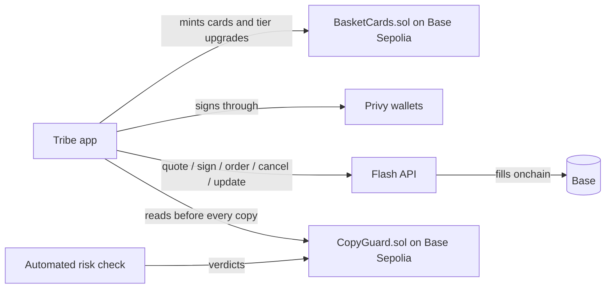

# Tribe: crypto ETFs you can copy, with NFT cards that level up

Tribe is a social trading app where anyone can build their own version of a crypto ETF and anyone else can copy it in one tap. Creating or copying an ETF earns an NFT card that levels up with performance. Every order is a [Flash](https://flash.definitive.fi/docs) advanced order, and an onchain guard pauses copying of a trader who is blowing up, before the next copy fills.

"ETF" is shorthand for a ready-made mix of assets. These aren't regulated ETFs: there's no fund, no shares and no fund manager. Each one is a public recipe of tokens and weights, and a copier buys the tokens and holds them in their own wallet. The app's screens call an ETF a "trade", and the code calls it a basket (`src/baskets.ts`).

Mobile-first web app (it reflows to a full desktop layout), installable as a PWA.

## ETFs
- **Build:** 1 to 10 tokens, at least 1% each, adding up to 100%, with an optional stop and target per token.
- **Mix and risk:** every ETF shows its share in Major coins, US stocks, Altcoins and Meme coins, plus a Steady, Balanced or Aggressive band (`src/assets.ts`). Classes come from a reviewed list of contract addresses, never a token's name or a creator's tag; anything unreviewed is Unclassified and counts as the riskiest kind. Confirm a token's address with its issuer before adding it (Coinbase's tokenized stocks are listed at base.org/assets). The agent API can filter on this, with an ETF counting for a class from 25% up.
- **Safety read:** every ETF shows rule-based checks on its stop, spread, record and creator's Guard status. No AI is involved.
- **Copy:** Tribe runs your limits and CopyGuard once for the whole amount, then places one Flash order per token at its weight. The tokens sit in your own wallet; nothing is pooled.
- **Partial fills:** if a token won't fill, the rest still go through. The copy shows as partly filled, and you can try again or close it.
- **Rebalance:** a published version never changes. New weights make a new version and send every copier a request showing the exact sells and buys. Nothing moves until they approve.
- **Record:** an ETF's value is an index that starts at 100 and moves with its weights and token prices, carried across versions, so it doesn't depend on what the creator holds.
- **Published by buying:** with `DRY_RUN=false` a creator publishes an ETF by buying it with Flash, one order per token with their stops. If nothing goes through, nothing is published. That stake isn't counted as a copier.
- **Real money, in testing:** with `DRY_RUN=false` a copy places real Flash orders, one per token, capped at `BASKET_LIVE_MAX_USD` (default $25) per copy. Use a Privy wallet: a 5-token copy through MetaMask would need about 10 to 20 prompts. Rebalancing stays in practice mode; to change versions, close the copy and copy again.

Single trades are now each trader's record rather than something you copy. Bots still trade one token, and copying a bot still goes through the follow rules and `mirror` in `src/copy.ts`.

## NFT cards
- **Earning:** creating an ETF earns an Original card and copying one earns a numbered Copy card, unlocked on screen right after the trade. Each is an SVG at `/card/<id>.svg` with metadata at `/card/<id>.json`.
- **Tiers:** cards go Base, Glitter, Holo and keep the highest tier reached. A Copy card goes by its holder's own return. An Original card goes by the ETF's return and its copiers, and needs both. The thresholds are in `src/card-tiers.ts`, and they're low for the demo.
- **Onchain:** each card is minted as a transferable ERC-721 on Base Sepolia (`contracts/BasketCards.sol`, `npm run cards:deploy`), with Tribe paying the gas and recording tier upgrades. Cards are marked as practice when their fills were simulated.
- **In the feed:** an ETF wears the Glitter or Holo finish while its return since launch is in that range. This look can drop back, unlike a card's tier.
- **Next:** rarity, card styles, patterns and sets are planned in [PLAN.md](PLAN.md).

## Safety
CopyGuard (`contracts/CopyGuard.sol`) holds a verdict on each trader, written by an automated risk check. **That check isn't running at the moment, so on the live app no trader gets paused and auto-copies wait for the follower's approval.** The rest of this section is how Guard works when the check runs. Right before every copy, Tribe reads `CopyGuard.halted(trader)` onchain (`guardGate` in `src/guard.ts`), so a lagging event watcher or an edited database can't let a paused trader through. The app can only be stricter than the chain, never looser.

It fails safe: if the chain can't be read, or the check hasn't reported for `GUARD_MAX_SILENCE_MIN`, auto-copies are held for the follower's approval. The Guard page shows this heartbeat, each run's verdicts trader by trader, and the onchain proof. Because verdicts live onchain, any other copy-trading app can read them too (`halted(trader)` / `haltedMany`).

## Social and gamified
Unique usernames with profile photos and bios, public profiles with a portfolio view, free follow or copy with Flash, a feed with story rings, levels, streaks, quests, badges, squads, a Hot pick and share cards. The game rewards safe behaviour: brackets, copying ETFs with stops, and researching before you copy.

## How Tribe uses Flash
| Area | Where |
| --- | --- |
| Trading flow on Flash advanced orders | `src/flash.ts`: quote → setup (approvals broadcast via Flash's `/setup-transaction`) → EIP-712 sign → order. Market with an **attached bracket** (entry + take-profit + stop-loss as one Flash order), limit, stop-loss, take-profit, standalone bracket, **TWAP**, stop-buy. Gasless signed **cancel**, **batch cancel** (a leader's cancel cancels every follower's resting copy) and **update** (move a live stop). The **orders WebSocket** delivers fills and close reasons live. **Permit2 with minimal allowance** is on by default, so no wallet carries an unlimited approval. **Limit orders with `expireTime`** power the chase limit: a copy never pays more than 1% above the leader's entry. `npm run flash:check` checks 9 order shapes, batch cancel, order listing and the stream against the live API. Full map: [docs/FLASH.md](docs/FLASH.md). |
| Onchain execution | `DRY_RUN=false` + `LIVE_WALLET_PRIVATE_KEY`: the trade form or a copied ETF places real Flash orders on Base; the feed card and Activity link the settlement tx (from Flash fills) on basescan. `npm run flash:check -- --live 5` places a real $5 bracketed buy from the terminal. |
| Social | Copy rules per trader (ask-first with Telegram approve buttons, or auto; ratio, max per trade, daily cap, stop-loss required), live feed with reactions and comments, leaderboard (profit, most copied, streaks, safest, squads), squads, quests and badges, share cards for **X** (1200×630) and **TikTok / Reels** (9:16, phone share sheet), a public `/top` leaderboard whose X preview is the rendered board, public profile pages that land new users on "Join and copy". |
| Bots | Any user can switch on a bot. It trades from their wallet and posts under their username, tagged **Bot** with a one-line thesis, next to their **Manual** trades. People copy that user and get both, by their own rules, and the profile shows the user's Manual vs Bot record side by side (`src/bots.ts`). |
| AI agents | **Tribe MCP server** (`src/mcp.ts`): any MCP client (Claude, Cursor) can read the leaderboard, look up a trader, check Guard, see your account, browse ETFs and copy one within your limits. Setup is on Settings → AI agent access. |
| Revenue | `flashIntegratorFeeBps` on every quote and order. Creators earn a share (`CREATOR_SHARE`) of the integrator fee on copies of their ETFs, read from Flash fills (`integratorFeeNotional`). |

## Architecture



| Path | What |
| --- | --- |
| `src/flash.ts` | Flash client: quotes, setup transactions, attached brackets, orders, fills, cancel, update, balances |
| `src/tracker.ts` | Places and tracks orders; turns an attached bracket into the position's protective order once the entry fills; simulated fills in dry-run |
| `src/baskets.ts` | ETFs: versions, copying, per-copy holdings, partial fills, rebalancing, the index |
| `src/cards.ts`, `src/card-tiers.ts`, `src/card-chain.ts`, `contracts/BasketCards.sol` | NFT cards: art, tiers, the minting worker and the contract |
| `src/copy.ts`, `src/rules.ts` | Fan-out to followers of a bot or trader by their rules |
| `src/guard.ts`, `contracts/CopyGuard.sol` | Risk snapshot, onchain halt watcher, the verdict contract |
| `src/privy.ts`, `src/privy-api.ts`, `web/` | Embedded wallets and automatic signing |
| `src/ask.ts` | Order proposals, used by bots and the trade form |
| `src/chief-api.ts`, `src/cat*.ts`, `src/views/chief.ts` | Ask Chief, **switched off**: no route, page or bot calls these, so no AI model runs for it |
| `src/views/*` | Server-rendered screens (from the Tribe design canvas) |

## Run it

Needs Node 22.5+.

```bash
npm install
npm run demo:reset     # deletes demo.db, then seeds traders, ETFs, followers, squads, and @kestrel's bot
npm run demo           # http://localhost:8787 → /demo signs you in, /director drives the story
```
Offline: simulated prices, fills and balances. `npm run demo` always runs dry, whatever `.env` says. Cards aren't minted in demo mode. See `DEMO.md` for the video script.

### Live Flash orders (Base mainnet)
```bash
npm run flash:check                 # quote, sign and submit every order type from an empty wallet (validates format; nothing executes)
npm run flash:check -- --live 5     # a real $5 WETH buy with take-profit and stop attached
```
In the app: `.env` → `DRY_RUN=false`, `DEMO=false`, `LIVE_WALLET_PRIVATE_KEY=` (USDC + a little ETH on Base), then `npm start`.

### NFT cards
`npm run cards:deploy` deploys `BasketCards` to Base Sepolia. Token ids are card ids, so each database needs its own contract. Set `BASKET_CARDS_ADDRESS` and `DEPLOYER_PRIVATE_KEY` to turn minting on.

### Tests
`npm test` (app, copy engine, ETFs, cards, HTTP integration, Privy, and the copy-time gate reading CopyGuard over JSON-RPC) · `npm run typecheck`.

## Verified
- All 7 Flash order types quote, sign and **pass Flash's submit validation** against the live API (`npm run flash:check` submits each from a fresh empty wallet; Flash accepts the body and EIP-712 signatures, including the attached bracket's, and refuses only for the zero balance). Cancel and update are built to the documented message formats but not yet exercised on a live order.
- CopyGuard and SeasonBoard deploy and behave on a real EVM (Ganache): ERC-165, replay protection, halt/resume, batch reads, season attestation.
- The copy-time gate is tested against the contract over JSON-RPC: a trader halted onchain is blocked, and a silent check or an unreachable chain means copies are held for approval.

## Not verified yet, or not built
- The automated risk check that feeds CopyGuard isn't running anywhere. The contract gate is in place, but no new verdicts reach it. Guard pauses in the demo are simulated.
- Real-money rebalancing is blocked in code until it's proven on live Flash. A stop on an ETF's total value, automatic rebalancing and a per-ETF Guard pause are not built.
- A real Flash order submitted and filled (needs a funded wallet; the flow is complete and `flash:check --live` does it).
- Wallets: accounts sign in with their own wallet and approve each trade there. Automatic signing (Wallet page) moves an account to a Privy embedded wallet with Tribe as a policy-limited signer. Run `npm run privy:check` after changing the policy in `src/privy.ts`. The browser enrollment flow still needs a full end-to-end run.
- The installable app (`src/pwa.ts`): checked in desktop Chrome only, not on a real iPhone or Android phone. Wallet sign-in from the installed app is untested, and there is no web push: the Push notifications toggle only saves a setting.
- Alert toggles for fills, stop/target hits, payouts and the weekly summary are saved but have no sender yet. Squad XP is lifetime, not per season.

Copy trading is risky. Nothing in Tribe is financial advice.
